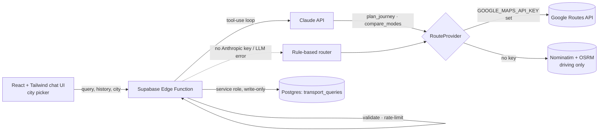

# India Transport Assistant

[](https://github.com/OWNER/REPO/actions/workflows/ci.yml)

A chat assistant for getting around Indian cities. Ask in plain English - "Howrah to Salt Lake Sector V by metro" or "Compare ways to get from Bandra to Churchgate" - and an LLM agent calls routing tools, then summarises the **real results**: duration, distance, metro/local-train/bus legs with stops and departure times, estimated fare in ₹, and live-traffic times for car and two-wheeler.

> Replace `OWNER/REPO` in the badge. Add a screenshot/GIF at `docs/demo.gif` and embed it here.

## Why India is a different problem

There is no free national equivalent of London's TfL API, and Indian Railways has no official public API. This project is designed around that reality:

- **Provider abstraction.** Tools talk to a `RouteProvider`; today that is the Google Routes API (transit + traffic-aware drive/two-wheeler/walk), with a keyless OpenStreetMap fallback (driving only). Swapping in city GTFS feeds (e.g. Delhi OTD, Kochi Metro) means implementing one interface.
- **City picker.** Names like "Sector 62" or "Camac Street" are ambiguous nationwide, so the selected city is added to place names and given to the model.
- **Two-wheelers and cabs matter.** `compare_modes` runs transit vs car vs two-wheeler in parallel, with partial-failure tolerance.
- **Honest limits.** Transit times are *scheduled*, not live vehicle positions. The bot never estimates auto/cab/bus fares and says it cannot check PNR, seat availability or live train status (use NTES/IRCTC).

## Architecture



| Layer | Choice | Why |
|---|---|---|
| Frontend | React 18, TypeScript (strict), Tailwind, Vite | Typed, small bundle (~50 kB gzip) |
| Backend | Supabase Edge Function (Deno) | No server to run; secrets stay server-side |
| AI | Claude tool use | Model chooses tools and writes the answer; facts come from the API |
| Data | Google Routes API / OSM | Real transit + traffic in Indian cities; keyless fallback |
| Storage | Postgres + RLS | Query analytics, locked down |

### Design decisions

- **Tools, not prompts-with-data.** The model can only report what a tool returned; the prompt forbids invented times, stops and fares.
- **Graceful degradation (three tiers).** Claude + Google → rule-based router + Google → rule-based router + OSM driving estimates. The app works with zero keys.
- **Bounded agent loop.** Max 4 steps, 10 s timeout per upstream call, 700 max output tokens.
- **Tool failures are data.** Errors go back to the model as JSON so it explains them instead of crashing.
- **Logging is server-only.** The browser cannot read or write the database.

## Getting started

Requires Node 18+ and a [Supabase](https://supabase.com) project. Claude and Google keys are optional.

```bash
npm install
cp .env.example .env          # set VITE_SUPABASE_URL and VITE_SUPABASE_ANON_KEY
supabase db push
supabase functions deploy transport-info
supabase secrets set ANTHROPIC_API_KEY=sk-ant-... GOOGLE_MAPS_API_KEY=... ALLOWED_ORIGIN=https://your-site
npm run dev                   # http://localhost:5173
```

| Secret | Required | Purpose |
|---|---|---|
| `GOOGLE_MAPS_API_KEY` | Recommended | Enables metro/train/bus routing, fares, live-traffic car & bike times (enable the **Routes API** and set billing/quotas) |
| `ANTHROPIC_API_KEY` | No | Enables the LLM agent; otherwise the rule-based router is used |
| `ANTHROPIC_MODEL` | No | Override model (default `claude-haiku-5-5`) |
| `OSM_CONTACT` | No | Contact string sent as User-Agent to Nominatim (their policy requires one) |
| `ALLOWED_ORIGIN` | Recommended | Restrict CORS to your deployed origin |

## Scripts

| Command | What it does |
|---|---|
| `npm run dev` | Dev server |
| `npm run check` | Lint + typecheck + tests + build (what CI runs) |
| `npm test` | Vitest, 60 tests; Google, OSM and Claude are mocked |

## Project structure

```
src/
  components/    TransportAssistant (UI + city picker), MessageText (XSS-safe renderer)
  hooks/useChat  conversation state, abort handling, history windowing
  lib/           api client, config, session id
supabase/
  functions/
    _shared/     routes (Google + OSM providers) · tools · agent loop · rules fallback · cities · format · validation · rate limit
    transport-info/index.ts   HTTP handler: CORS, limits, provider selection, logging
  migrations/    schema + RLS hardening
```

## Security

- Server-side validation: length caps, history limited to `user`/`assistant`, session-id regex, **city allow-list**.
- RLS enabled with **no** anon/authenticated policies on `transport_queries`; only the edge function (service role) writes.
- LLM output is rendered as text nodes - no `dangerouslySetInnerHTML`; tool results are labelled as data in the system prompt.
- Keys live in Supabase secrets, never in the client bundle. **Restrict the Google key** to the Routes API and set a daily quota - it is billable.
- **Privacy:** query text is stored with an anonymous per-tab session id. Add a retention job (e.g. delete after 30 days) before real use.

## Known limitations

- Transit data is schedule-based; no live bus/metro positions. Coverage depends on what Google has for each city (strong in metros, patchy elsewhere).
- Fare is shown only when the API can price every leg; auto/cab fares are never estimated.
- No Indian Railways long-distance support (no official API).
- Keyless mode uses public OSM servers (fair-use, driving only, no traffic) - demo use only.
- Rate limiting is per-isolate and in-memory, so best-effort.
- Verified against mocked responses; there is no live end-to-end test in CI.

## Roadmap

- Delhi OTD GTFS-realtime for live bus positions; Kolkata/Kochi/Mumbai metro GTFS where published
- Hindi/Bengali/Tamil input and replies
- Streaming responses, shared-store rate limiting, step-free routing option
- Eval set of ~30 Indian-city queries to track answer quality across model versions

## License

MIT - see [LICENSE](LICENSE).
